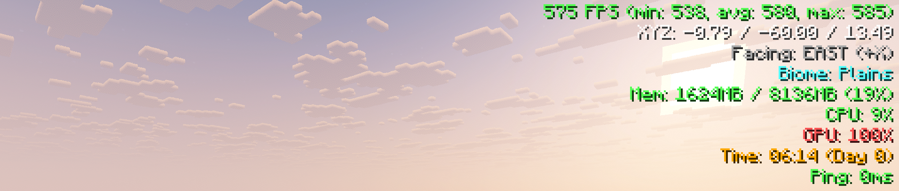
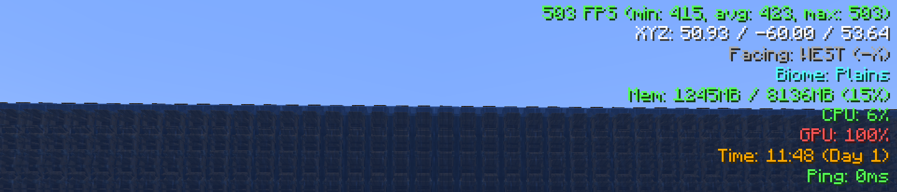
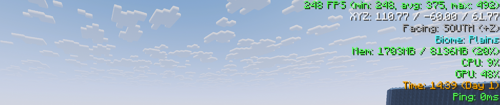

<div align="center">

# Reggadium

**Next-Generation Performance and Create Mod Optimization Engine for Minecraft 1.21.1 (NeoForge)**

[](https://minecraft.net/)
[](https://neoforged.net/)
[](https://openjdk.org/)
[](LICENSE)

<br/>

Reggadium is a high-performance client-side optimization mod built specifically for Minecraft 1.21.1 on NeoForge. Designed for heavily modded environments and industrial factories, Reggadium introduces low-level rendering optimizations, zero-allocation block entity frustum culling, and deep performance pipelines for the Create Mod alongside native Embeddium and Sodium compatibility.

</div>

---

## In-Game Performance Benchmarks

### 1. Baseline Performance (With and Without Shaders)

Real in-game metrics with the Reggadium Performance HUD active:

<div align="center">
  <p><b>Without Shaders: 1368 FPS (Average: 1335 FPS)</b></p>
  
</div>

<br/>

<div align="center">
  <p><b>With Shaders Enabled: 575 FPS (Average: 580 FPS)</b></p>
  
</div>

---

### 2. Extreme Stress Test (30,000+ Create Mod Blocks)

Stress-testing a massive grid of 30,000+ Create mod kinetic blocks:

<div align="center">
  <p><b>30,000 Create Blocks (Without Shaders): 593 FPS (Average: 423 FPS)</b></p>
  
</div>

<br/>

<div align="center">
  <p><b>30,000 Create Blocks (With Shaders): 248 - 492 FPS (Average: 375 FPS)</b></p>
  
</div>

---

## Core Features and Optimizations

### 1. Native Off-Heap SBB Rendering Pipeline
* Direct Memory Streaming: Replaces Create's standard buffer builder with ReggadiumByteBuffer, streaming vertices directly into native off-heap memory buffers via LWJGL memory stacks.
* Quad Diffuse and Color Memoization: Diffuse lighting calculations (dot products, vector normalizations) are calculated once per quad instead of four times per vertex. For quads sharing uniform tint colors, final packed colors are computed once per quad, reducing vertex arithmetic by up to 75%.
* UV Offset Hoisting: Texture coordinate shifts in scrolling animations precompute target deltas once outside loop bodies, eliminating sprite active hook re-entries on animated textures.
* Perspective Backface Culling: Discards non-visible backfacing quads on 3D kinetic models before vertex submission.

---

### 2. Zero-Allocation Block Entity Culling
* Elimination of Heap Garbage: Standard Minecraft and Create call getRenderBoundingBox() every frame, allocating thousands of short-lived AABB objects per second.
* Relative Render Box Caching: Classifies block entities via an ultra-fast ClassValue table:
  * Always Visible: Beacons, End Gateways, End Portals, and Structure blocks bypass frustum tests.
  * Chests: Single and double chests use an expanded relative box without heap allocations, preventing double-chest clipping artifacts.
  * Standard Blocks: 1x1x1 blocks test directly against the view frustum as primitive double coordinates.
  * Custom Kinetic Machines: Bounding boxes are computed once on block state updates and stored as relative offsets, eliminating runtime AABB allocations entirely.

---

### 3. Create Mod Kinetic and Physics Throttling
* Kinetic LOD Rotation: Simplifies angle math using precomputed radian multipliers and steps rotational animation frequencies for distant mechanisms (> 16-32 blocks).
* Stationary Kinetic Sleep: Skips rendering passes for dormant or unpowered kinetic components located beyond 16 blocks.
* Client-Side Belt Throttling: Staggers client-side simulation ticks for distant conveyor belts, reducing CPU load in large automation setups.
* Distant Contraption Collision Bypass: Skips client-side collision calculations for moving contraptions outside player interaction range.
* Audio and Particle Culling: Attenuates and culls ambient kinetic mechanical soundscapes and distant fan particles.

---

### 4. Entity, Particle, and Shadow Occlusion
* Aggressive Entity Culling: Automatically culls distant dropped item entities (> 32 blocks) and experience orbs (> 24 blocks) outside camera view.
* Directional Particle Culling: Tests particle bounding boxes directly against the view frustum, preventing offscreen particles from degrading framerates.
* Entity Shadow Distance Culling: Discards shadow render passes for entities located beyond 16 blocks.

---

### 5. Modular Performance HUD and Diagnostics
Reggadium features a lightweight, standalone performance overlay decoupled completely from render optimizations:
* Metrics: Real-time FPS, Extended Framerates (Min / Avg / Max), Frame Times, GPU Utilization (via OpenGL queries), Memory / RAM allocation, CPU Load, Coordinates, Facing Direction, Biome, Game Time, and Network Ping.
* Zero Profiling Overhead: OpenGL GPU timer queries only execute when the GPU HUD element is enabled.
* Customization Options:
  * Screen Placement: Top-Left, Top-Right, Bottom-Left, Bottom-Right.
  * Visual Customization: Color Themes, Background Opacity, Text Contrast, and Coordinate Precision toggles.

---

## Configuration Guide

Reggadium can be fully configured via the in-game options menu or by editing config/reggadium-client.toml.

```toml
[general]
    # Master switch to globally enable or disable all Reggadium optimizations
    enableOptimizations = true
    # Display real-time in-game FPS counter
    showFps = true

[extra]
    # Master switch to globally enable or disable the Extra HUD overlay
    enableExtraHud = true
    showFpsExtended = false
    showCoords = false
    showFacing = false
    showBiome = false
    showMemory = false
    showCpu = false
    showGpu = false
    overlayCorner = "TOP_LEFT"
    hudScale = 100
    backgroundOpacity = "MEDIUM"

[performance]
    # Accelerate Create mod SuperByteBuffer rendering using direct memory writers
    fastSuperByteBuffer = true
    # Enable perspective backface culling for kinetic models
    backfaceCulling = true
    # Zero-allocation block entity frustum culling
    cullBlockEntities = true
    # Distance and frustum culling for kinetic mechanisms
    kineticCulling = true
    # Kinetic animation level-of-detail math optimization
    kineticLod = true
    # Skip rendering passes for motionless kinetics
    skipStationaryKinetics = true
    # Adaptive client-side tick throttling for conveyor belts
    cullBelts = true
    # Cull particles outside the camera frustum
    cullParticles = true
    # Distance culling for items and experience orbs
    cullEntities = true
    # Distance culling for entity shadows
    cullShadows = true
```

---

## Compatibility Matrix

| Mod / Framework | Supported Versions | Notes |
| :--- | :--- | :--- |
| Minecraft | 1.21.1 | Native Target |
| NeoForge | 21.1.265+ | Fully Supported |
| Create Mod | 6.0.5+ | Deep performance pipeline |
| Embeddium | 1.0.15+ | Native memory writer adapter and video options tab |
| Sodium | 0.8.13+ | Full API support and video options tab |
| Iris / Oculus / Emberlens | Latest | Compatible with shader rendering passes |

---

## Credits and Acknowledgements

* Embeddium and Sodium Teams: For chunk rendering architecture and performance foundations.
* Emberbium and Emberlens (shuttheirprayer / Misanthropy): For architectural insights into zero-allocation bounding box culling, quad memoization, and instanced rendering.
* Simibubi and The Create Team: For creating the Create Mod.
* Reggarf: Author and maintainer of Reggadium.

---

<div align="center">
  <sub>Built for modded Minecraft performance on NeoForge 1.21.1.</sub>
</div>
