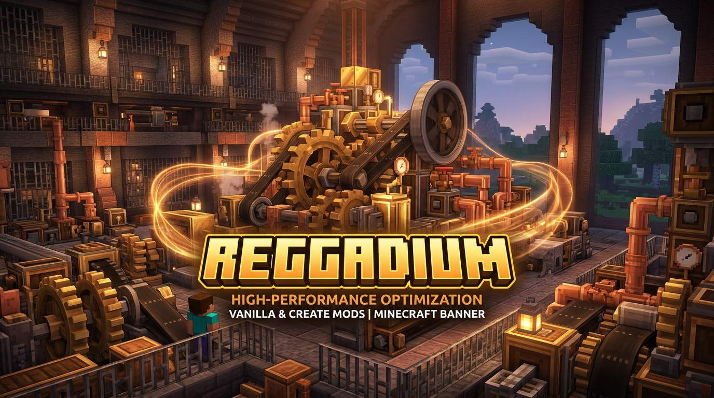
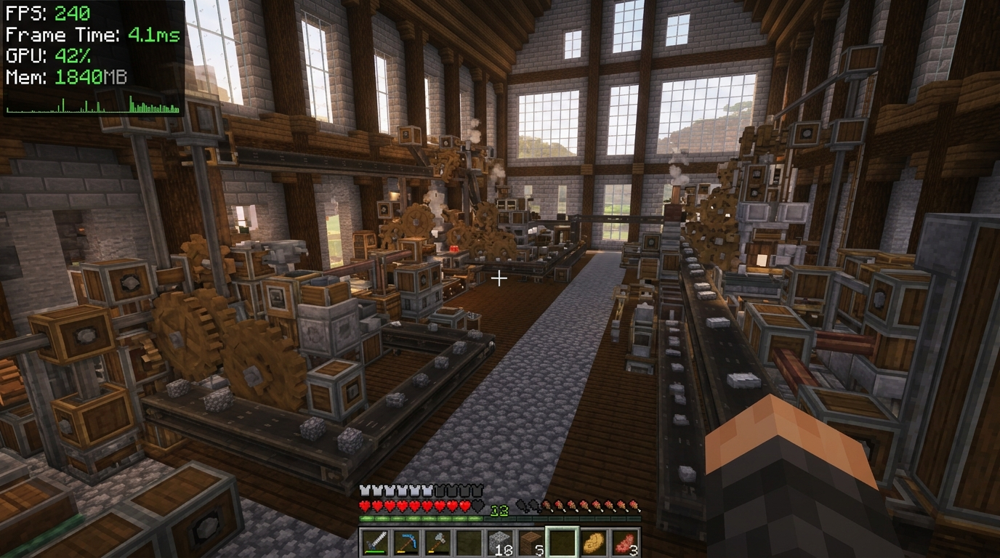

<div align="center">

# ⚙️ Reggadium

**Next-Generation Performance & Create Mod Optimization Engine for Minecraft 1.21.1 (NeoForge)**

[](https://minecraft.net/)
[](https://neoforged.net/)
[](https://openjdk.org/)
[](LICENSE)

<br/>



<br/>

**Reggadium** is a comprehensive, client-side performance modification built specifically for **Minecraft 1.21.1 on NeoForge**. Designed from the ground up for modded environments, Reggadium introduces modern low-level rendering optimizations, zero-allocation block entity frustum culling, and deep specialized performance pipelines for the **Create Mod** alongside native **Embeddium** and **Sodium** integration.

</div>

---

## 📸 In-Game Showcase

<div align="center">
  
  <p><i>A massive Create factory running with rock-solid framerates, zero-allocation culling, and the customizable Reggadium Extra HUD.</i></p>
</div>

---

## ⚡ Core Features & Innovations

### 🚀 1. Native Off-Heap SBB Rendering Pipeline
* **Off-Heap Direct Memory Streaming**: Replaces Create’s standard buffer builder with `ReggadiumByteBuffer`, streaming vertices directly into native memory buffers via LWJGL memory stacks.
* **Quad Diffuse & Color Memoization**: In models with dozens of identical quads (shafts, cogwheels, gearboxes), diffuse lighting calculations (dot products and vector normalizations) are calculated once per quad instead of 4 times per vertex, cutting shader arithmetic by up to 75%.
* **UV Coordinate Hoisting**: Precomputes texture delta offsets outside loop bodies for `shiftUVScrolling`, eliminating repeated sprite active hook re-entries on animated textures.
* **Perspective Backface Culling**: Automatically discards occluded backfacing quads on 3D kinetic models before vertex submission.

---

### 📦 2. Zero-Allocation Block Entity Culling
* **Elimination of Per-Frame Garbage Allocation**: Vanilla Minecraft and Create call `getRenderBoundingBox()` every frame, allocating thousands of temporary `AABB` instances every second.
* **Relative Render Box Caching**: Classifies block entities via an ultra-fast `ClassValue` table:
  * **Always Visible**: Beacons, End Gateways, End Portals, and Structure blocks bypass frustum math entirely.
  * **Chests**: Accurately bounds single and double chests with an expanded `[-1, 0, -1, 2, 2, 2]` box without object allocations, preventing double chest popping artifacts.
  * **Standard 1×1×1 Blocks**: Tested directly as primitive doubles against the view frustum.
  * **Custom Kinetic Mechanisms**: Bounding boxes are computed once on block state updates and stored as relative offsets, maintaining high visual fidelity with zero heap allocations.

---

### ⚙️ 3. Create Mod Kinetic & Physics Throttling
* **Kinetic LOD Rotation**: Simplifies angle math using precomputed radian multipliers and steps rotational animation frequencies for distant mechanisms (> 16–32 blocks).
* **Stationary Kinetic Sleep**: Completely skips rendering passes for dormant or unpowered kinetic components located beyond 16 blocks.
* **Client-Side Belt Throttling**: Staggers client-side simulation ticks for distant conveyor belts, freeing up valuable CPU cycles in massive automation hubs.
* **Distant Contraption Collision Bypass**: Skips expensive client-side collision calculations for moving contraptions positioned beyond player interaction ranges.
* **Audio & Particle Culling**: Attenuates and culls kinetic mechanical soundscapes and distant fan/air-current particles.

---

### 👁️ 4. Entity, Particle & Shadow Occlusion
* **Aggressive Entity Culling**: Automatically culls distant dropped item entities (> 32 blocks) and experience orbs (> 24 blocks) outside focus.
* **Directional Particle Culling**: Tests particle bounding boxes directly against the view frustum, preventing offscreen particles from degrading framerates.
* **Entity Shadow Distance Culling**: Discards shadow render passes for entities located beyond 16 blocks.

---

### 📊 5. Modular Performance HUD & Diagnostics
Reggadium features a lightweight, standalone performance overlay decoupled completely from render optimizations:
* **Metrics**: Real-time FPS, Extended Framerates (Min / Avg / Max), Frame Times, GPU Utilization (via OpenGL queries), Memory / RAM usage, CPU Load, Coordinates, Facing Direction, Biome, Game Time, and Network Ping.
* **Zero Profiling Overhead**: OpenGL GPU timer queries only run when the GPU HUD element is actively displayed.
* **Full Customization**:
  * **Screen Placement**: Top-Left, Top-Right, Bottom-Left, Bottom-Right.
  * **Visual Styling**: 10+ Color Themes, Background Opacity, Text Contrast, and Coordinate Precision toggles.

---

## 🛠️ Configuration Guide

Reggadium can be fully configured via the in-game options menu or by editing `config/reggadium-client.toml`.

```toml
[general]
    # Master switch to globally enable or disable all Reggadium optimizations
    enableOptimizations = true
    # Display real-time in-game FPS counter
    showFps = true

[extra]
    # Master switch to globally enable or disable the Extra HUD overlay
    enableExtraHud = true
    showFpsExtended = false
    showCoords = false
    showFacing = false
    showBiome = false
    showMemory = false
    showCpu = false
    showGpu = false
    overlayCorner = "TOP_LEFT"
    hudScale = 100
    backgroundOpacity = "MEDIUM"

[performance]
    # Accelerate Create mod SuperByteBuffer rendering using direct memory writers
    fastSuperByteBuffer = true
    # Enable perspective backface culling for kinetic models
    backfaceCulling = true
    # Zero-allocation block entity frustum culling
    cullBlockEntities = true
    # Distance and frustum culling for kinetic mechanisms
    kineticCulling = true
    # Kinetic animation level-of-detail math optimization
    kineticLod = true
    # Skip rendering passes for motionless kinetics
    skipStationaryKinetics = true
    # Adaptive client-side tick throttling for conveyor belts
    cullBelts = true
    # Cull particles outside the camera frustum
    cullParticles = true
    # Distance culling for items and experience orbs
    cullEntities = true
    # Distance culling for entity shadows
    cullShadows = true
```

---

## 🧩 Compatibility Matrix

| Mod / Framework | Supported Versions | Notes |
| :--- | :--- | :--- |
| **Minecraft** | `1.21.1` | Native Target |
| **NeoForge** | `21.1.265+` | Fully Supported |
| **Create Mod** | `6.0.5+` | Full deep optimization pipeline |
| **Embeddium** | `1.0.15+` | Native memory writer adapter & video menu tab |
| **Sodium** | `0.8.13+` | Full API support & custom video options tab |
| **Iris / Oculus / Emberlens** | Latest | Compatible with shader rendering passes |

---

## 📜 Credits & Acknowledgements

* **Embeddium & Sodium Teams**: For pioneering modern chunk rendering architecture and performance foundations.
* **Emberbium & Emberlens** (*shuttheirprayer / Misanthropy*): For architectural insights into zero-allocation bounding box culling, quad memoization, and instanced rendering.
* **Simibubi & The Create Team**: For creating the magnificent Create Mod.
* **Reggarf**: Author and maintainer of Reggadium.

---

<div align="center">
  <sub>Built with ❤️ for modded Minecraft performance on NeoForge 1.21.1.</sub>
</div>
